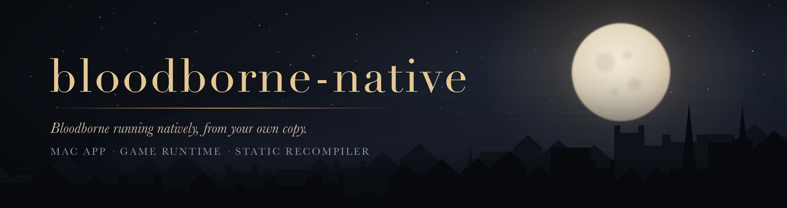

Bloodborne (PS4) running natively, starting with Apple Silicon Macs, from the player's own copy
of the game. Open source (GPL), built on [bbport](https://github.com/deadinside28/bloodborne_pc)
by deadinside28 and on [shadPS4](https://github.com/shadps4-emu/shadPS4).

| | |
|---|---|
| **[bloodborne-mac](https://github.com/bloodborne-native/bloodborne-mac)** | The macOS app, packaging, releases and player guides. [Download](https://github.com/bloodborne-native/bloodborne-mac/releases/latest) |
| **[bloodborne-launcher](https://github.com/bloodborne-native/bloodborne-launcher)** | The independent launcher: profiles, saves and settings. macOS integration works today; Windows and Linux integration are planned. |
| **[bloodborne-runtime](https://github.com/bloodborne-native/bloodborne-runtime)** | Runs the game: the PS4 system libraries and a Vulkan renderer |
| **[bloodborne-recomp](https://github.com/bloodborne-native/bloodborne-recomp)** | An x86-64 → arm64 translator and a static recompiler that turns the game's code into native code ([status](https://github.com/bloodborne-native/bloodborne-recomp/wiki/Recompilation-status)) |

No game files or game code are included anywhere: you need your own dump of Bloodborne with the
1.09 update.

Not affiliated with Sony Interactive Entertainment, FromSoftware, shadPS4 or bbport.
*Bloodborne* is a trademark of Sony Interactive Entertainment.
